<div align="center">
  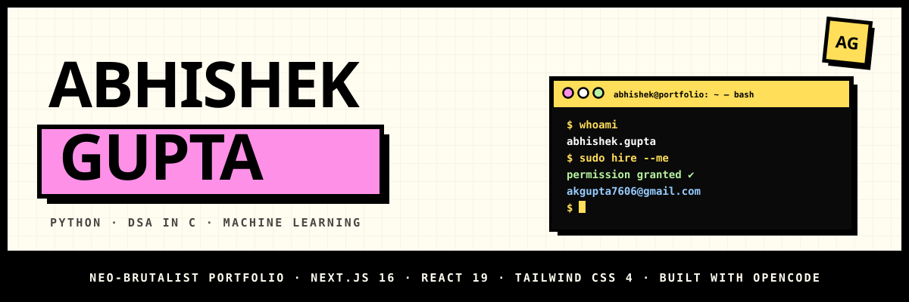
</div>

<br/>

<h1 align="center">by_opencode</h1>

<p align="center">
  <strong>The personal portfolio of Abhishek Gupta</strong><br/>
  B.Tech CSE pre-final year @ Brainware University
</p>

<p align="center">
  <a href="https://nextjs.org"></a>
  <a href="https://react.dev"></a>
  <a href="https://www.typescriptlang.org"></a>
  <a href="https://tailwindcss.com"></a>
  <a href="https://eslint.org"></a>
  <a href="https://opencode.ai"></a>
</p>

<p align="center">
  <a href="#overview">Overview</a> ·
  <a href="#preview">Preview</a> ·
  <a href="#features">Features</a> ·
  <a href="#tech-stack">Tech stack</a> ·
  <a href="#architecture">Architecture</a> ·
  <a href="#signature-interactions">Interactions</a> ·
  <a href="#design-system">Design system</a> ·
  <a href="#getting-started">Getting started</a> ·
  <a href="#built-with-opencode">Built with OpenCode</a>
</p>

---

> **This repository was built with [OpenCode](https://opencode.ai)** — an open-source AI coding agent.
> The design system, every component, the copy, the asset pipeline, and this README were
> pair-programmed with an agent that edits files, runs builds, and verifies the result in a real
> browser.

## Overview

A single-page, statically prerendered portfolio built as a **neo-brutalist artifact**: cream paper,
3px black borders, hard offset shadows, flat punchy colors, and zero border radius.

It is deliberately small. Three runtime dependencies. No UI kit, no animation library, no CMS, no
database. All content lives in one typed file, all motion is CSS or a few lines of React, and the
page ships as static HTML with a handful of small client components.

The site tells a story in eight chapters — who I am, what I work with, a live terminal, the journey
so far, the road ahead, proof in the form of certificates, and a way to get in touch.

### By the numbers

| | |
| --- | --- |
| **Runtime dependencies** | 3 — `next`, `react`, `react-dom` |
| **Client components** | 5 — everything else is a server component |
| **Prerendered pages** | 1 — the entire site |
| **Documents in the vault** | 6 certificates + 1 internship completion letter |
| **Animation libraries** | 0 |
| **Content files** | 1 — `src/data/profile.ts` |

## Preview

<table>
  <tr>
    <td width="50%">
      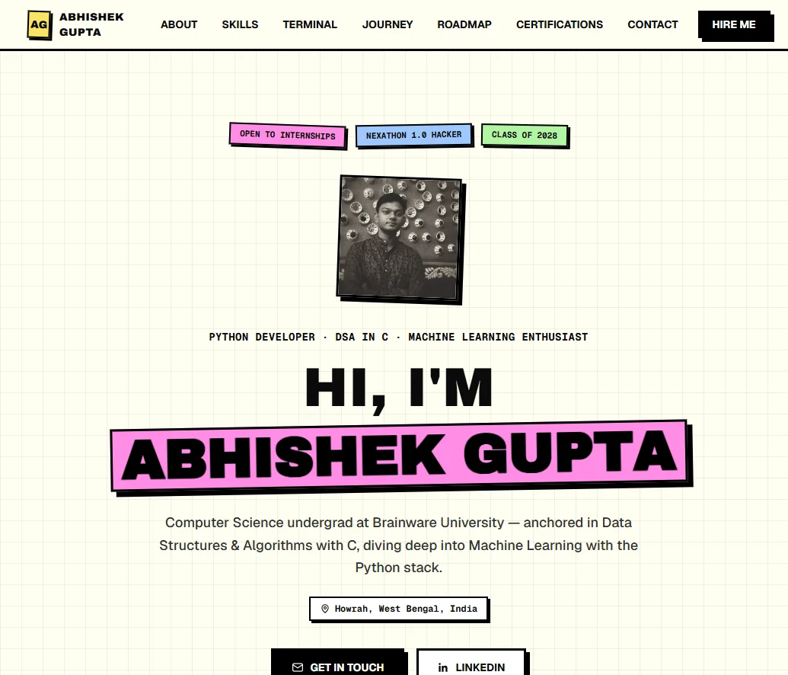
    </td>
    <td width="50%">
      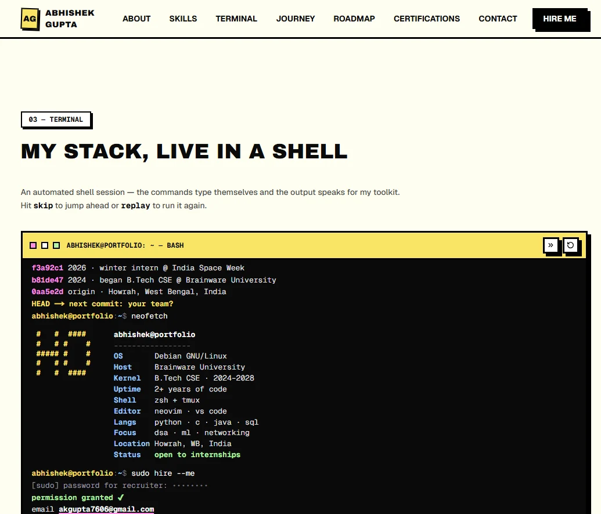
    </td>
  </tr>
  <tr>
    <td>
      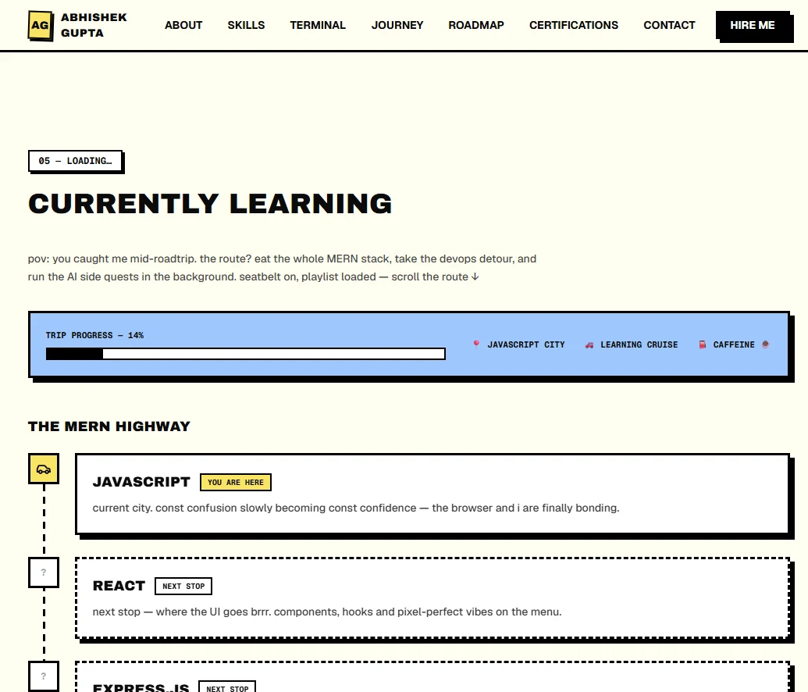
    </td>
    <td>
      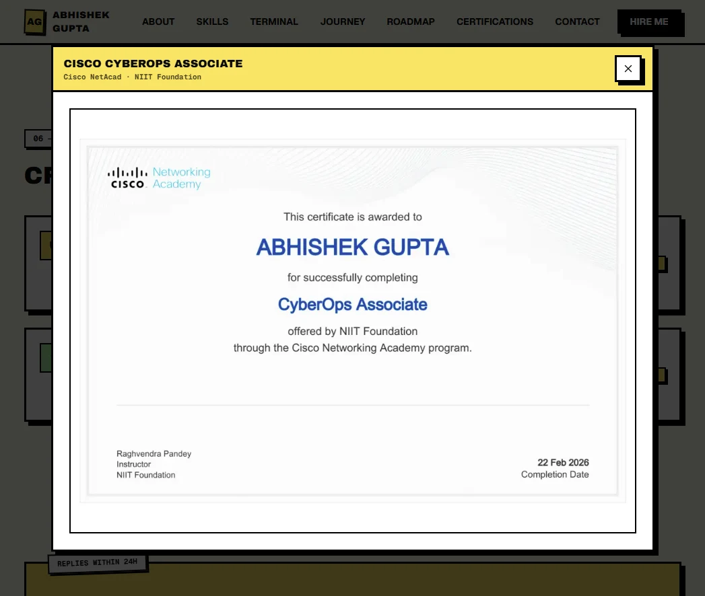
    </td>
  </tr>
</table>

<sub>Captured from the production build running on `localhost:3000`.</sub>

## Features

- **Liquid-fill name animation** — each character pops in, then fills bottom-up with a tilted
  liquid surface. Pure CSS, no JavaScript, no animation library. See
  [`globals.css`](src/app/globals.css) and [`hero.tsx`](src/components/hero.tsx).
- **Self-typing terminal** — a nine-command shell session that types itself, prints real-looking
  output, supports skip and replay, pauses when off-screen, and falls back to a static transcript
  for reduced-motion users. See [`terminal.tsx`](src/components/terminal.tsx).
- **Certificate vault** — six certificates and one internship letter, rendered from the original
  PDFs into WebP, opened in a brutalist popup that closes on `X`, backdrop click, or `Escape`.
  See [`cert-modal.tsx`](src/components/cert-modal.tsx).
- **Road-trip roadmap** — a Gen-Z storytelling section: the MERN highway, a DevOps detour, AI side
  quests, and a "fast-forward to 2027" spoiler where the future is already shipped.
- **Typed content model** — jobs, education, certificates, and the roadmap are all typed objects in
  one file. Adding a certificate is a five-line edit.
- **Responsive by construction** — the name can only wrap between words, never mid-word, at any
  viewport width.
- **Accessible motion** — `prefers-reduced-motion` is honored in CSS and in the terminal engine;
  the modal traps focus, locks scroll, and restores focus on close.
- **Static output** — `next build` prerenders the whole page. No server runtime required to host it.

## Tech stack

| Logo | Technology | Version | Role | Why it is here |
| :---: | --- | --- | --- | --- |
|  | **Next.js** | 16.4.6 | Framework | App Router, React Server Components, static prerendering, Metadata API, `next/font`, `next/image`, and Turbopack builds. |
|  | **React** | 19.3.0 | UI runtime | Server-first rendering. Only five components opt into the client bundle. |
|  | **TypeScript** | 5.x · strict | Language | Discriminated unions for timeline entries, roadmap stops, and certificate icons. Content errors fail the build. |
|  | **Tailwind CSS** | 4.3.3 | Styling | CSS-first `@theme` tokens. No `tailwind.config.js`; the design system lives in `globals.css`. |
|  | **ESLint** | 9 | Code quality | Flat config with `eslint-config-next`; `npm run lint`. |
|  | **Node.js** | 20.9+ | Runtime | Next.js 16 engine requirement. |
|  | **OpenCode** | — | AI coding agent | The pair programmer behind every file. See [Built with OpenCode](#built-with-opencode). |

**What is *not* in the stack:** a component library, an icon package, a CSS-in-JS runtime, an
animation library, a form library, a database, or an ORM. The icon set in
[`icons.tsx`](src/components/icons.tsx) is hand-drawn inline SVG.

## Architecture

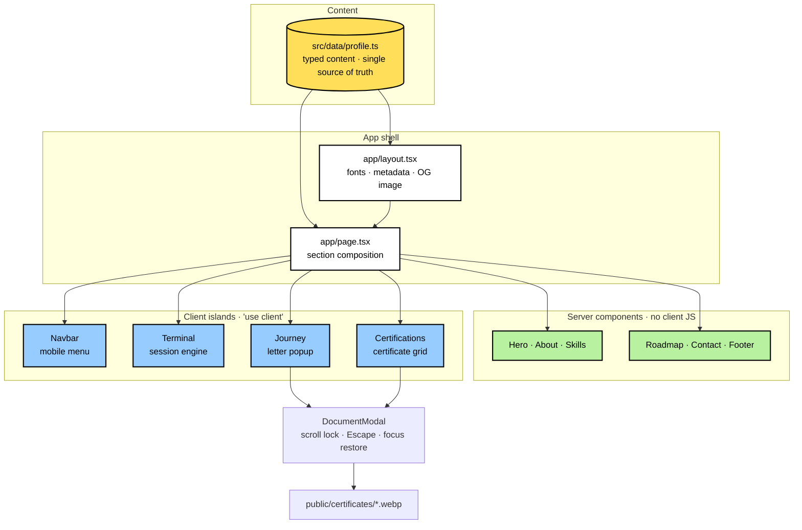

The page is a server component. Content is imported at build time, HTML is prerendered, and only
the interactive pieces opt into the client bundle:

| Block | Type | Ships JS | Why |
| --- | --- | :---: | --- |
| Hero, About, Skills | Server | No | Static content and `next/image` only. |
| Marquee | Server | No | Pure CSS keyframes. |
| Terminal | Client | Yes | Typing loop, skip/replay, visibility observers. |
| Journey | Client | Yes | Opens the internship letter popup. |
| Roadmap | Server | No | Story content; the pulsing marker is CSS. |
| Certifications | Client | Yes | Grid state plus the document popup. |
| Navbar | Client | Yes | Mobile menu toggle and `aria-expanded`. |
| Contact, Footer | Server | No | Links only. |

### The page, as a story

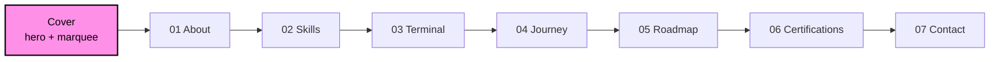

## Signature interactions

### The liquid name

The hero name is not an image or a canvas. It is text, split into per-character spans, animated with
two CSS keyframes:

1. `nb-pop` drops each character in from below with a springy overshoot — outline only, like an
   empty container.
2. `nb-fill` raises a solid duplicate of the character from 110% below the baseline to above the
   cap height. The clip-path top edge is deliberately slanted, so the rising surface reads as a
   liquid meniscus rather than a progress bar.

```css
.liquid-char {
  color: transparent;
  -webkit-text-stroke: 0.035em #000;
  animation: nb-pop 0.55s cubic-bezier(0.34, 1.56, 0.64, 1) both;
  animation-delay: calc(var(--i) * 55ms);
}

.liquid-char::before {
  content: attr(data-char);
  color: #000;
  clip-path: polygon(-20% 110%, 120% 110%, 120% 110%, -20% 110%);
  animation: nb-fill 0.45s ease-out forwards;
  animation-delay: calc(var(--i) * 55ms + 230ms);
}
```

Each character carries its own `--i` index, so a single `calc()` produces the left-to-right stagger.
Characters are grouped into `.liquid-word` spans with `white-space: nowrap`, which guarantees the
name can only wrap **between** words — never `ABHISHE` / `K GUPTA` on a narrow phone. Screen
readers receive the plain name via `aria-label`; the animated spans are `aria-hidden`.

Reduced-motion users see plain, filled text — the entire animation block lives inside
`@media (prefers-reduced-motion: no-preference)`.

### The scripted terminal

An automated shell session — no fake loading spinner, actual typed commands with jittered keystrokes
(22–56ms per character) and output printed line by line.

| Command | What it demonstrates |
| --- | --- |
| `whoami` | Identity and focus |
| `cat about.txt` | Education, DSA foundation, ML trajectory |
| `ls ~/skills/` | Toolkit grouped by domain |
| `./measure --skills` | Skill bars rendered as block characters |
| `grep -i achievements resume.md` | Internship and hackathon record |
| `sql -e "SELECT cert, issued_by FROM certs;"` | A real SQL result table |
| `git log --oneline journey/main` | Career timeline as commits |
| `neofetch` | ASCII "AG" monogram + system-style profile card |
| `sudo hire --me` | Contact details with a wink |

The session engine is a plain `async` loop over a typed script, not a library:

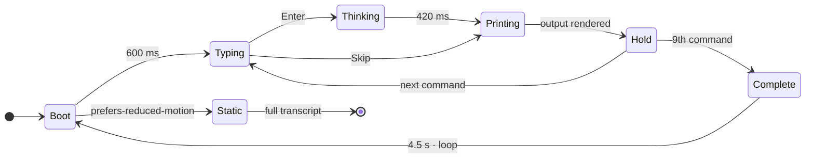

It also listens to an `IntersectionObserver` and `visibilitychange`, so the animation freezes when
the section is off-screen or the tab is hidden — no timers burning in the background. **Skip** jumps
to the end of the current pass; **Replay** restarts the loop.

### The certificate vault

Six certificates and one internship completion letter were rendered from their original PDFs with
PyMuPDF and Pillow into WebP assets, then wired into a shared document popup.

| Document | Issuer |
| --- | --- |
| Cisco CyberOps Associate | Cisco NetAcad · NIIT Foundation |
| Privacy-Preserving Cryptographic Security | ISEA · ISI Kolkata |
| Python for Data Science | NPTEL |
| Nexathon 1.0 | Hackathon · Brainware University |
| Computer Hardware Basics | Cisco Networking Academy |
| Quantum Computing Seminar | Brainware University |
| Internship Completion Letter | India Space Lab · India Space Week |

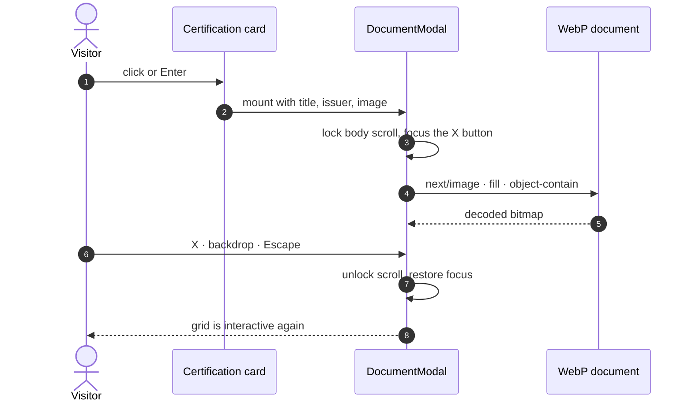

Cards with a document are real `<button>` elements with `aria-haspopup="dialog"`; cards without one
stay plain, non-interactive surfaces. The same modal component powers both the certificate grid and
the journey timeline.

## Design system

Everything is defined once, in [`src/app/globals.css`](src/app/globals.css), using Tailwind v4's
CSS-first `@theme` syntax.

| Token | Value | Used for |
| --- | --- | --- |
| `--color-cream` | `#FFFDF0` | Page background |
| `--color-ink` | `#000000` | Borders, text, shadows |
| `--color-nbyellow` | `#FFDE59` | Terminal chrome, current stop, highlights |
| `--color-nbpink` | `#FF90E8` | Name plate, marquee, text selection |
| `--color-nbblue` | `#96CCFF` | Stats, trip HUD, progress |
| `--color-nbgreen` | `#B8F2A0` | Success and completed states |
| `--color-nbpurple` | `#C4A7FF` | Accent cards |
| `--color-nborange` | `#FFA552` | DevOps detour |

**The rules**

- Every surface gets a `3px` black border — `2.5px` on chips.
- One shadow, no blur: `6px 6px 0 #000` for cards, `5px 5px 0 #000` for buttons.
- No gradients, no glassmorphism, no rounded corners.
- Hover moves the element *toward* its shadow; `:active` flattens it entirely.
- Type is a three-voice system: **Archivo Black** for display, **Geist** for body,
  **Geist Mono** for anything terminal-flavored.

```css
.nb-card {
  border: 3px solid #000;
  background: #fff;
  box-shadow: 6px 6px 0 #000;
}

.nb-btn:hover {
  transform: translate(-2px, -2px);
  box-shadow: 7px 7px 0 #000;
}
```

## Content model

No CMS, no JSON files scattered around. One typed module is the source of truth for the whole site.

```ts
export type Certification = {
  title: string;
  issuer: string;
  icon: "shield" | "brain" | "award" | "cpu" | "spark" | "lock";
  image?: string; // WebP under /public/certificates
};
```

Because `image` is optional, a certification without a scan still renders as a static card. The
moment an image is added, the card becomes a button that opens the vault. The same pattern powers
timeline entries (optional `orgUrl` becomes a link, optional `document` becomes a popup button).

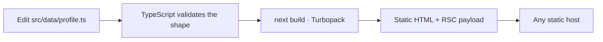

## Project structure

```text
by_opencode/
├─ src/
│  ├─ app/
│  │  ├─ layout.tsx        # fonts, metadata, Open Graph image
│  │  ├─ page.tsx          # section composition + marquee
│  │  ├─ globals.css       # design tokens, brutalist classes, keyframes
│  │  └─ icon.png          # favicon
│  ├─ components/
│  │  ├─ navbar.tsx        # sticky nav + mobile sheet
│  │  ├─ hero.tsx          # portrait, liquid name, stats
│  │  ├─ about.tsx         # summary + spoken languages
│  │  ├─ skills.tsx        # grouped toolkit
│  │  ├─ terminal.tsx      # scripted shell session
│  │  ├─ journey.tsx       # experience, education, letter popup
│  │  ├─ roadmap.tsx       # MERN highway story
│  │  ├─ certifications.tsx# certificate grid
│  │  ├─ cert-modal.tsx    # shared document popup
│  │  ├─ contact.tsx
│  │  ├─ footer.tsx
│  │  ├─ section.tsx       # numbered section shell
│  │  └─ icons.tsx         # hand-drawn inline SVG icon set
│  └─ data/
│     └─ profile.ts        # every word on the site
├─ public/
│  ├─ certificates/        # 6 certificates + 1 letter, all WebP
│  ├─ profile.webp         # hero portrait
│  └─ profile-square.webp  # 1200×1200 Open Graph image
├─ docs/                   # banner + screenshots used by this README
├─ next.config.ts
├─ package.json
└─ tsconfig.json
```

## Getting started

**Prerequisites:** Node.js **20.9+** (required by Next.js 16) and npm.

```bash
# install dependencies
npm install

# start the dev server on http://localhost:3000
npm run dev
```

Production build:

```bash
npm run build
npm run start
```

| Script | What it does |
| --- | --- |
| `npm run dev` | Dev server with Turbopack and hot reload. |
| `npm run build` | Production build; prerenders `/` as static HTML. |
| `npm run start` | Serves the production build. |
| `npm run lint` | Runs ESLint 9 with the Next.js flat config. |

> If you are editing content, you only need `src/data/profile.ts`. Everything else is presentation.

## Deployment

The production build is **fully static** — the build log marks `/` as `○ (Static)`. There is no
server runtime, database, or environment variable involved, so it deploys to any static host
(Vercel, Netlify, Cloudflare Pages, GitHub Pages) or any Node.js server via `npm run start`.

No hosting configuration is committed yet, which is why there is no live-demo badge at the top.

## Accessibility and motion

- **Reduced motion** — the name animation, marquee, pulsing roadmap marker, and terminal typing all
  respect `prefers-reduced-motion`. The terminal renders its complete transcript instead of animating.
- **Keyboard** — every interactive card is a `<button>`; the modal moves focus to its close button,
  closes on `Escape`, and restores focus to the trigger when it unmounts.
- **Screen readers** — the animated name exposes a plain `aria-label`; decorative characters, dots,
  and ASCII art are `aria-hidden`; the terminal is a labeled `role="region"`.
- **Scroll handling** — the modal locks body scroll while open; section anchors use `scroll-mt-24`
  so headings are not hidden under the sticky navbar.
- **Images** — every document and portrait has descriptive alt text; icons are decorative or labeled.
- **Contrast** — black text on cream, yellow, pink, blue, green, purple, and orange surfaces; status
  is never communicated by color alone (chips carry text labels too).

## Performance

- **3 runtime dependencies.** No UI kit, icon package, animation library, or state manager.
- **Static first.** The page is prerendered to HTML; only five components hydrate.
- **Fonts self-hosted** through `next/font` — no render-blocking request to Google Fonts.
- **Images optimized** — WebP documents (60–166 KB each), explicit dimensions, `sizes` on the
  modal image, and `priority` only on the hero portrait.
- **No wasted timers** — the terminal pauses via `IntersectionObserver` and `visibilitychange` when
  it is not visible.
- **CSS-only motion** — the liquid name, marquee, and pulse never touch the main thread.

## Built with OpenCode

This project is a demonstration of what an AI coding agent can do when it is treated like a
collaborator instead of an autocomplete.

Every line of code in this repository was written in pair-programming sessions with
**[OpenCode](https://opencode.ai)**. The workflow was not "generate a website" — it was a sequence
of concrete briefs, reviews, and browser checks:

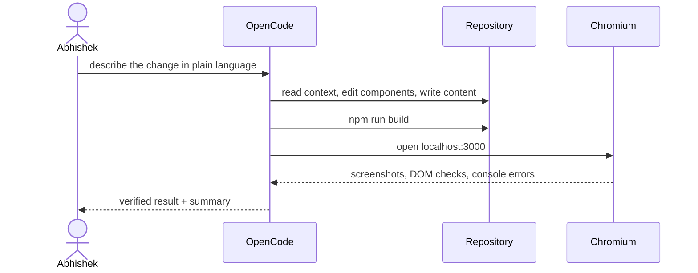

What that looked like in practice:

- **Design system** — the neo-brutalist tokens, chunky borders, hard shadows, and type scale were
  iterated in CSS, then applied across every section.
- **A pivot** — the first version had a 3D voxel playground. It was removed, `three.js` and the
  React Three Fiber stack were uninstalled, and the animated terminal was built in its place.
- **Real documents** — the certificate PDFs were rendered to WebP with PyMuPDF and Pillow, inspected
  page by page, and wired into the popup with correct aspect ratios.
- **Verification** — the agent ran production builds and drove a real Chromium instance: opening
  every modal, clicking skip and replay, checking the mobile name wrap, and reading console errors.
- **This README** — including the banner, the Mermaid diagrams, and the screenshots captured from
  the running build.

The result is a codebase that is small enough to read in one sitting, and a portfolio that is
honest about being machine-assisted and human-directed.

## What's next

- [ ] Deploy to a custom domain and add a live-demo link
- [ ] Add a projects section with case studies and source links
- [ ] Interactive terminal mode with a small set of real commands
- [ ] Per-certificate PDF downloads alongside the image popup
- [ ] Lighthouse and axe checks in CI
- [ ] Notes on DSA in C and applied machine learning

## Contact

| | |
| --- | --- |
| **Email** | [akgupta7606@gmail.com](mailto:akgupta7606@gmail.com) |
| **LinkedIn** | [linkedin.com/in/akgupta766](https://www.linkedin.com/in/akgupta766) |


## License

The **code** in this repository is released under the [MIT License](LICENSE).

The **personal content** — the name, biography, photographs, certificates, internship letter, and
copy — is © 2026 Abhishek Gupta and is not licensed for reuse. Please learn from the implementation,
not from the identity.
